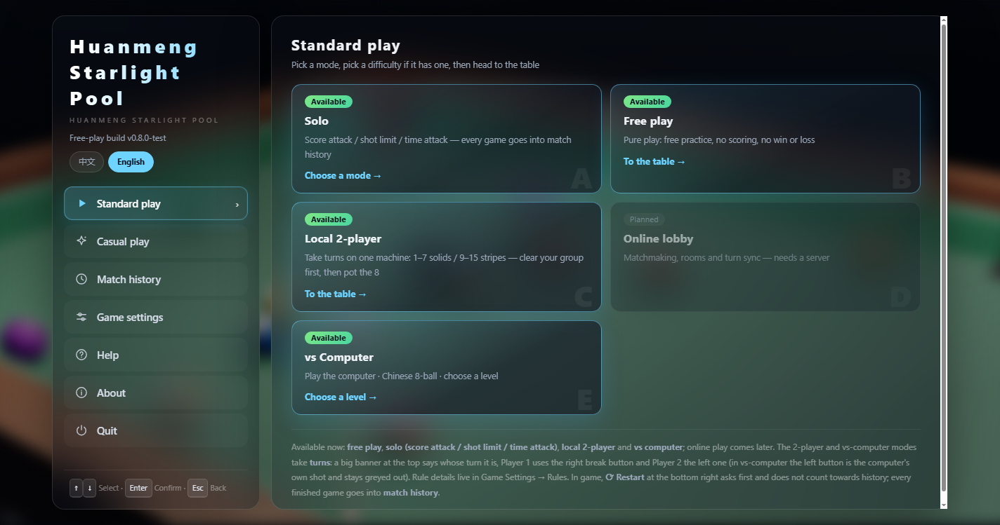

# Huanmeng Starlight Pool (hmzq)

**English** · [中文](README.md)

A 3D pool / billiards game rendered with **Three.js** and simulated with **Rapier3D**, built on a real
9-foot table (playing surface 2.54 × 1.27 m, ball diameter 57.15 mm, ball mass 0.17 kg).

Runs in the browser, as a Windows desktop app (Electron), and on Android (Capacitor).
The whole interface is available in **Chinese and English** — switch it from the launcher or in-game.

> 「Huanmeng」(幻梦) is a series name. This game is made by **幻梦-拾光回廊工作室 (Huanmeng · Shiguang Corridor Studio)**
> and developed with WorkBuddy. Future titles in the series will carry the same name.



## Features

| | |
|---|---|
| **Real table, real physics** | Fixed-step Rapier3D simulation, hand-written rolling friction, CCD on every ball, circular pocket throats judged by the ball's centre — not a “close to the hole” cheat |
| **Real 3D table model** | A glTF 9-foot table (17k triangles, 256px embedded textures) with the collision hull fitted to the model's measured outer edge, and the pocket judgement circles moved onto the model's own pockets instead of cutting fake holes into the felt |
| **Game modes** | Free play · Score attack · Shot limit · Time attack; local 2-player; vs computer |
| **Chinese 8-ball rules** | Solids 1–7 / stripes 9–15, the 8-ball decides the game, three foul types with penalties, groups lock after the break |
| **Computer opponent** | Four levels driven by real physics: it aims with ghost-ball geometry + throw compensation, solves its own power, and its “hand shake” (`aimErr`) is what changes per level — roughly 30 / 45 / 70 / 90 % pot rate |
| **Launcher** | Multi-level routing (play / casual / history / settings / help / about / quit), quality presets, audio panel, rule settings, per-mode cards |
| **Camera & aiming** | Free orbit, top-down orthographic, tracking cam that pulls back after the shot; drag anywhere to charge, the aim direction locks while charging |
| **Bilingual UI** | Chinese ⇄ English, instant, persisted, shared between launcher and game (see below) |
| **Three hosts** | Web (`npm run build`) · Electron desktop (`npm run dist:exe`) · Android APK (`npm run android:apk`) |
| **Down to old kernels** | Build target ES2019; a kernel self-check card explains *why* an old WebView cannot run the wasm the physics engine needs (Chrome / Android WebView 75+) instead of showing a white screen |

## Quick start

```bash
npm install

npm run dev          # browser dev server on :5183 (no transpiling — desktop browsers only)
npm run preview:lan  # build (ES2019) + preview on :5184, prints the LAN URL for phone testing
npm run build        # production build into dist/ (includes the launcher)
```

Open `dist/launcher.html` to start from the launcher; `dist/index.html` boots straight into the game.

### Tests & checks

```bash
npm test             # 719 physics/logic assertions + 31 renderer assertions (headless, no browser)
npm run check        # syntax floor (≤ ES2019) + kernel self-check card + runtime API floor
npm run check:smoke  # headless Chrome: really start the game, verify canvas/WebGL/physics, console clean
npm run check:solo   # end-to-end, 15 stages: launcher routing → ball in hand → settings → HUD → result → local 2-player → vs computer
npm run check:i18n   # i18n: static dictionary audit + headless Chrome “switch to English, scan for leftover Chinese, switch back”
```

The browser checks need a prior `npx vite build` — they test `dist/`.

> Headless Chrome on this machine has to be started with `--disable-gpu --disable-gpu-sandbox`,
> otherwise the sandboxed GPU never brings SwiftShader up. That flag is already baked into `test/browser-*.mjs`.

## Controls

| Action | Mouse / keyboard |
|---|---|
| Aim | move the mouse (free / tracking modes), the cue follows the cursor |
| Charge | hold the left button anywhere; a power bar follows the cursor (0 → 1 → 0 in ~4 s); <kbd>Space</kbd> works too |
| Shoot | release |
| Rotate camera / zoom | right-drag to orbit, wheel to zoom (top-down mode pans instead) |
| Reset view | the ↺ Reset view button |
| Restart game | <kbd>R</kbd> (a confirmation dialog appears first) |
| Help | the <kbd>?</kbd> button, bottom left |
| Ball in hand | drag the cue ball anywhere legal |

| Set the contact point | drag the red dot on the cue-ball pad (appears where you pressed) |
| Recentre the contact point | double-click the pad |

On phones and tablets: one finger orbits, two fingers pan or pinch-zoom, and a dedicated **Break / Shoot**
button at the bottom right charges while you hold it (a large power bar rises from the bottom edge).
While charging, drag the red dot on the pad with a second finger to apply spin.

## Game modes

- **Solo** — Free play (no scoring), Score attack, Shot limit, Time attack. Every finished game is recorded in
  the match history (replayable, with a per-game detail dialog).
- **Local 2-player** — take turns on one machine; each player has their own break button, ball groups lock after
  the break, the other player's balls can be faded out, and fouls follow the rules you pick in the launcher.
- **vs Computer** — Chinese 8-ball rules, the computer plays player 2, thinks → turns the cue → shoots on its own,
  and announces which ball it is going for and with how much power.
- **Online** — planned (a separate server project); the card in the launcher is disabled for now.

## Spin (`src/spin.js` + `SHOT.spin`)

Hold the shoot button and a **cue-ball pad** appears right where you pressed (fixed to the bottom
left on touch). The red dot on it is the **contact point** — centre by default, which reproduces the
old shot bit for bit.

| Drag to | Normalised | Result |
|---|---|---|
| centre | (0, 0) | plain centre-ball hit — identical to the pre-0.8 shot (long-table calibration untouched) |
| top | (0, +1) | **follow**: the cue ball keeps rolling forward (roll factor 0.6 → 0.8) |
| bottom | (0, −1) | **draw**: it comes back (roll factor → −0.95, genuine backspin) |
| left / right | (∓1, 0) | **side spin**: cushion rebound angle shifts up to ±15° and object balls get thrown off line |
| diagonal | (x, y) | both at once (the length is clamped to 1) |

`spinAngular()` (in `sim.js`, pure maths) turns the offset into angular velocity:

```js
ω_roll = (v/R) · roll,   roll = 0.6 + (sy >= 0 ? 0.2 : 1.55) · sy
ω_y    = clamp(sideGain · sx · v/R, ±24)
```

The up/down gains are **deliberately asymmetric**: the cloth friction model does not respond to over-spin at
all (roll 0.8 / 1.0 / 2.15 all travel the same +0.45 m), so follow tops out at 0.8 while draw needs −0.95 to
actually pull the cue ball back.

**Throw** (`applyThrow()`): with side spin, the cue ball's contact friction deflects the object ball —
right english throws it left — up to ~5.3° at full spin. Without it, side spin would have literally no
effect on a plain object-ball hit (user-reported gap).

Cushion english is applied by hand (`applyCushionEnglish()`): Rapier's contact friction only turns a
perpendicular rebound by **1.4°** at ω.y = 24, so the outgoing velocity is rotated by
`θ = clamp(0.6·|ω.y|, ±15°)` **and** the rolling spin is rebuilt along the new direction — rotating only the
velocity leaves the ball slipping and the cloth drags it straight again within 4 cm (measured: 3.6 cm of
lateral drift instead of 6.8 cm).

The computer always shoots from dead centre (`{ x: 0, y: 0 }`): the four AI levels were calibrated on
centre-ball shots, and letting it apply spin would invalidate every pot-rate number.

## Language switching (i18n)

Both the launcher and the in-game settings panel have a **中文 / English** switch. The choice is stored in
`hmzq.lang.v1` (Electron: `window.__electron.settings`, web: `localStorage`) and is shared by both pages.

The implementation deliberately translates by **looking up the Chinese source string**, not by key table:

- 400+ strings live across the HTML and a dozen JS modules. Adding a key to every call site would mean touching
  hundreds of places, and missing one leaves one Chinese sentence on screen.
- Instead `public/i18n-en.js` holds a `Chinese → English` dictionary (486 exact entries + 85 regex rules for
  strings with variables such as `Player 2 wins`, `3 shots left`, `20 pts`), and `public/i18n.js` walks the DOM at
  runtime. Game code keeps writing Chinese into the DOM — translation is taken over centrally.

Three constraints that cost real debugging time:

1. **Never replace `innerHTML` of an element that carries interaction** — it would drop the event listeners
   already bound to it. Whole-block replacement only applies to pure formatting tags (`b`, `i`, `span`, …) whose
   children have no attributes; anything with a `button` / `input` is handled node by node.
2. **Translations must be reversible.** Originals are kept in a ledger; switching back to Chinese only restores
   nodes whose current value is still exactly what we wrote, so content changed by game logic meanwhile is left
   alone. And switching back must *not* walk the DOM again — the translator does not look at the current language,
   so a second walk would immediately flip the restored Chinese back to English.
3. **Our own output must not be re-translated** — decided by comparing against the recorded value, not with a
   suppression flag (flags race with the asynchronous `MutationObserver`).

A `MutationObserver` picks up everything created later (charging percentage, computer hints, results, history
rows), so no game code needs to know that i18n exists.

Two verification layers keep this honest: a static audit (`scripts/i18n-audit.mjs`) that fails when a Chinese
string has no English entry, and an end-to-end scan (`test/browser-i18n.mjs`) that fails when *any* Han character
is still on screen after switching to English — which is what catches dynamically assembled strings.

## Project layout

```
public/          launcher (html/css/js, multi-level routing), i18n runtime + dictionary,
                 launcher audio & quality panels, background art, audio assets
src/             game
  constants.js     every tunable parameter (TABLE / PHYS / SHOT / RULES / SCORE / CUE / CAM / AUDIO / AI)
  layout.js        pure geometry (table, pockets, rack positions) — shared by browser and tests
  sim.js           engine-independent physics policy (randomised transfer, break shockwave, speed clamp)
  modes.js rules.js   mode rules and ball groups (Chinese 8-ball; snooker / Russian are placeholders)
  duo.js duo-ui.js    local 2-player / vs computer engine (pure logic) + turn banner and two break buttons
  auto-aim.js ai.js   ghost-ball aiming with throw compensation / computer opponent with four levels
  table.js balls.js textures.js table-model.js   geometry, balls, procedural textures, real GLB table
  state.js shot.js pockets.js   state tree, shooting & rest detection, potting and fuses
  camera-rig.js aimer.js stage.js   camera rig, aiming, renderer stage
  hud.js input.js settings.js help.js   HUD, input, settings dialog, help copy
  quality.js mobile.js   quality presets, mobile shell (touch handling, responsive CSS)
  main.js          entry point: build the world → wire subsystems → run the loop
electron/        main process + preload (desktop only)
scripts/         dev/build helpers, asset pipeline (GLB prepare/fix), screenshots, packaging
docs/            design notes, model evaluation, performance reports, screenshots
test/            headless physics/logic suites, renderer suite, browser end-to-end checks
```

## Notes on the physics

- Fixed-step accumulator that **accumulates across frames** — otherwise physics freezes on high-refresh displays
  and input gets stuck.
- Rolling friction is a hand-written model (`applyRollFriction`) rather than Rapier's damping, so the feel is
  reproducible and testable; rotation about the vertical axis decays separately (contact-point velocity is zero
  there, so Coulomb friction gives no torque).
- A ball is potted when its **centre enters the circular throat** and starts to drop; the sensor is only a
  fallback. The throat radius is per pocket type (corner 57 mm / middle 60 mm) — every judgement goes through
  `throatRadiusOf()`.
- The break is a normal shot, but a shockwave plus randomised transfers spread the rack. Break parameters and AI
  error levels are **calibrated by sweep scripts**, so changing pocket geometry means re-running both sweeps.

## Requirements

- **Browsers** — recent Chrome / Edge, or Android System WebView 75+ (the physics wasm uses non-MVP
  instructions). Opening the game inside WeChat works and is the easiest path on a phone.
  Old kernels (e.g. MIUI's built-in browser, WebView 71) get a self-check card that explains the reason.
- **Desktop build** — Windows; `npm run dist:exe` produces an installer and a portable build in `release/`.
- **Android build** — Android SDK plus a keystore (`android/keystore.properties`), then `npm run android:apk`.

## Credits

- Engine: [Three.js](https://threejs.org/), [Rapier3D](https://rapier.rs/) (`@dimforge/rapier3d-compat`),
  [Vite](https://vitejs.dev/), [Electron](https://www.electronjs.org/), [Capacitor](https://capacitorjs.com/)
- Music: “Backbay Lounge” by Bar Bugz (CC BY 3.0) · “Jazz at the park” (CC0 public domain)
- Table model: generated with Tripo, then decimated and repaired by the scripts in `scripts/`
- Sound effects (cue, ball hits, cushions, pots) are synthesised in real time with the Web Audio API — no samples

## License

[MIT](LICENSE) © 2026 韶光丶幻梦
